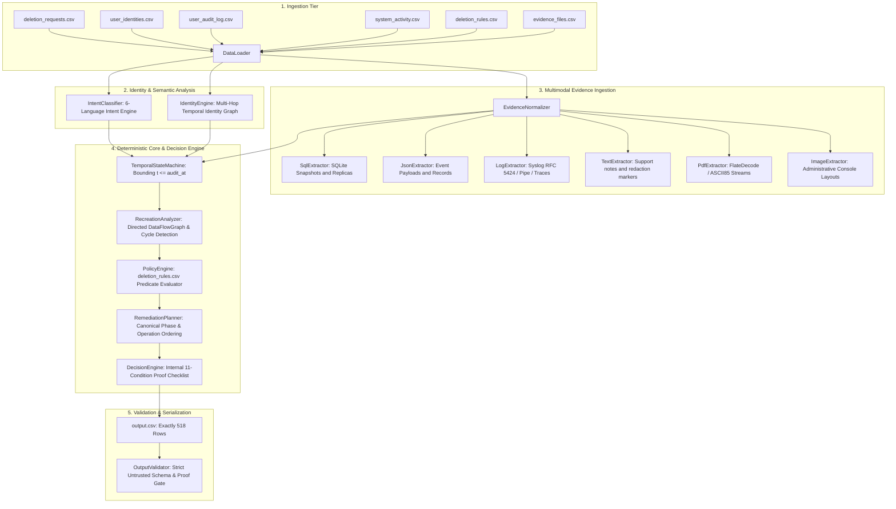

# Ghost Data Still Exists — Autonomous Deletion-Audit Agent

[](https://www.python.org/downloads/)
[](https://opensource.org/licenses/MIT)
[-brightgreen.svg)]()
[]()
[](https://wwww.hackerrank.com/contests/hackerrank-orchestrate-october26/challenges/ghost-data-still-exists)

> **Official HackerRank Challenge:** [HackerRank Orchestrate (October 2026) — Ghost Data Still Exists](https://wwww.hackerrank.com/contests/hackerrank-orchestrate-october26/challenges/ghost-data-still-exists)  
> **Participant Solution Repository:** [https://github.com/rohansng/Ghost_challenge_hackerrank](https://github.com/rohansng/Ghost_challenge_hackerrank)

---

## 1. Title & Overview

This repository contains the autonomous deletion-audit agent built for the **HackerRank Orchestrate (October 2026)** competition: **Ghost Data Still Exists**.

In distributed commerce systems, privacy deletion workflows often report **Complete** while personal data quietly persists in database replicas, access logs, support attachments, data warehouse exports, search indexes, analytics caches, cold storage archives, or system backups. Active background synchronization pipelines, database failovers, and automated disaster-recovery restore processes can also recreate personal data previously deleted from its source.

This solution reconstructs user identity graphs, audits multi-modal evidence strictly at historical cutoff timestamps (`audit_at`), analyzes data flows and restore paths for recreation risk, applies platform deletion rules, and produces a deterministic prediction file (`output.csv`) adhering strictly to the official challenge contract.

---

## 2. Challenge

### Official Problem Summary
The challenge requires auditing 518 evaluation requests from `dataset/deletion_requests.csv`. For each request, the agent must:
1. **Verify Authorization:** Determine whether the natural-language request actually authorizes deletion (as opposed to data access, rectification, export, or marketing opt-outs).
2. **Resolve Identity:** Reconstruct the subject's current and historical identity graph from `user_identities.csv` and `user_audit_log.csv`.
3. **Reconstruct Evidence State at `audit_at`:** Determine the state of personal data strictly at the case cutoff timestamp (`audit_at`), ignoring subsequent modifications and rejecting unverified workflow claims (`reported_status`).
4. **Detect Recreation Risks:** Analyze active data synchronization connectors and backup restore paths in `system_activity.csv` that could recreate deleted data.
5. **Apply Deletion Rules:** Enforce `deletion_rules.csv` across all identified resources, ensuring required records are retained, direct identifiers are redacted or anonymized, and account tombstones preserve only permitted internal identifiers.
6. **Plan Remediation & Verification:**
   - For `INCOMPLETE` deletions: emit evidence-backed findings, an ordered future remediation plan, and post-remediation verification checks.
   - For `COMPLETE` deletions: emit evidence-backed verification steps proving the compliant state.
   - For `NOT_APPLICABLE` requests: return an empty steps list (`[]`).

---

## 3. Solution Overview

The solution is implemented as a 100% standard-library Python architecture requiring zero external pip packages and zero runtime generative model API calls:

- **Multilingual Request Intent Classifier:** Analyzes request text across 6 languages (English, French, Spanish, Portuguese, Japanese, Korean) to detect whether deletion is authorized.
- **Multi-Hop Temporal Identity Engine:** Traverses audit logs chronologically to resolve the complete subject graph (current and past emails, phone numbers, and pseudonymized hashes).
- **Multi-Modal Evidence Normalizer:** Ingests and indexes all 94 participant-visible evidence files across SQLite snapshots, structured JSON/JSONL records, Syslog/trace logs, plain-text notes, and decompressed PDF streams.
- **Strict Temporal State Machine:** Filters and reconciles observations strictly at `t <= audit_at`, preventing information leakage from subsequent events.
- **Directed Recreation Analyzer:** Constructs a directed `DataFlowGraph` from `system_activity.csv` to detect active synchronization pipelines and unrestrained backup restore risks.
- **Rule-Based Policy Engine:** Evaluates predicates from `deletion_rules.csv` for `DELETE`, `REDACT`, `ANONYMIZE`, `RETAIN`, and `ACCOUNT_TOMBSTONE` treatments.
- **Internal 11-Condition Decision Model:** Evaluates an explainable proof checklist to establish whether deletion completeness is proven.
- **Canonical Step Planner:** Emits strictly ordered steps following canonical phase progression (`FINDING` -> `REMEDIATION` -> `VERIFICATION`), exact operation priority ranks, and alphabetical tie-breaking.
- **Strict Untrusted Output Validator:** Verifies all 518 output rows against schema, provenance, ordering, and evidence constraints.

---

## 4. Architecture

The engine is structured into decoupled, single-responsibility modules:



---

## 5. Quickstart

### Prerequisites
- Python 3.10 or higher.
- Standard library only (no `pip install` required).
- Tested on Windows (PowerShell, Python 3.12); compatible with POSIX-compliant environments via standard library modules (`os`, `sys`, `pathlib`, `csv`, `json`, `sqlite3`, `zlib`, `base64`, `re`, `datetime`).

### Execution
Clone the repository and run the engine from the repository root:

```bash
# Execute the full deletion-audit pipeline across all 518 cases
python code/main.py

# Execute with automated output validation
python code/main.py --validate

# Run single-case diagnostic audit
python code/main.py --case-id case_33
```

---

## 6. CLI Commands

The command-line interface in [`code/main.py`](file:///d:/Hackerrank_hackathon/code/main.py) supports the following flags:

| Flag | Argument | Description | Default |
|:---|:---|:---|:---|
| `--dataset` | `PATH` | Path to dataset directory | `dataset` |
| `--output` | `PATH` | Output CSV destination path | `output.csv` |
| `--case-id` | `CASE_ID` | Diagnostic execution for a single request ID | `None` (processes all cases) |
| `--validate` | Flag | Automatically runs strict untrusted validator on generated output | `False` |
| `-v`, `--verbose` | Flag | Enables detailed logging to stdout | `False` |
| `-q`, `--quiet` | Flag | Suppresses progress logging (emits errors only) | `False` |

---

## 7. Core Pipeline

For each request in `dataset/deletion_requests.csv`, the audit pipeline executes the following deterministic stages:

1. **Request Intent Classification:** Analyzes `request_text` to verify whether deletion is authorized. If non-deletion intent is detected, classifies as `NOT_APPLICABLE` with `steps_json = []`.
2. **Identity Resolution:** Maps the request email to a stable `user_id` and collects all current and historical emails, phone numbers, and SHA-256 email hashes.
3. **Evidence Extraction & Normalization:** Retrieves evidence observations matching any subject identifier or related resource ID from the indexed multi-modal evidence store.
4. **Temporal Bounding (`t <= audit_at`):** Excludes observations captured or timestamped strictly after `audit_at`.
5. **Recreation & Restore Analysis:** Evaluates active data flows and backup restore paths from `system_activity.csv`.
6. **Policy Evaluation:** Matches resource categories against `deletion_rules.csv` to determine required states (`ABSENT`, `REDACTED`, `ANONYMIZED`, `PRESENT`).
7. **Decision & Step Planning:** Evaluates the internal 11-condition proof checklist, assigns the final deletion status, and constructs canonical, ordered steps.

---

## 8. Identity Resolution

The [`IdentityEngine`](file:///d:/Hackerrank_hackathon/code/identity_engine.py) performs bidirectional identity reconstruction:

- **Current Snapshot Ingestion:** Ingests `user_identities.csv` to map `email` <-> `user_id`, phone numbers, and pre-computed email hashes.
- **Historical Audit Traversal:** Traverses `user_audit_log.csv` chronologically to track email changes, name modifications, and telephone updates.
- **Multi-Hop Search Space:** Resolves queries where the request email is a historical address that has since been replaced in `user_identities.csv`.
- **Conflict Handling:** Flags any ambiguous identity links (such as multiple user IDs claiming the same identifier) for incomplete status handling.

---

## 9. Evidence Processing

[`EvidenceNormalizer`](file:///d:/Hackerrank_hackathon/code/evidence_normalizer.py) indexes the 94 participant-visible evidence files described in `dataset/evidence_files.csv`:

| Modality | Extractor | Implementation Details |
|:---|:---|:---|
| **SQL Snapshots** | [`SqlExtractor`](file:///d:/Hackerrank_hackathon/code/extractors/sql_extractor.py) | Executes SQL scripts against in-memory SQLite instances; inspects tables (e.g. `customer_profiles`, `customer_accounts`, replicas) for subject identifiers. |
| **JSON / JSONL** | [`JsonExtractor`](file:///d:/Hackerrank_hackathon/code/extractors/json_extractor.py) | Recursively parses structured payloads for subject identifiers, field redactions, and system configurations. Preserves manifest capture timestamps. |
| **System Logs** | [`LogExtractor`](file:///d:/Hackerrank_hackathon/code/extractors/log_extractor.py) | Parses RFC 5424 Syslog (`<15>1 ...`), pipe-delimited records, and bracketed trace logs using standard-library regular expressions. |
| **Support Notes** | [`TextExtractor`](file:///d:/Hackerrank_hackathon/code/extractors/text_extractor.py) | Scans plain text for direct identifiers, phone formats, and redaction markers (such as `[REDACTED]`). |
| **PDF Documents** | [`PdfExtractor`](file:///d:/Hackerrank_hackathon/code/extractors/pdf_extractor.py) | Decompresses PDF `/Contents` text streams (`/FlateDecode` and `/ASCII85Decode`) using standard-library `zlib` and `base64`. |
| **Console Screenshots** | [`ImageExtractor`](file:///d:/Hackerrank_hackathon/code/extractors/image_extractor.py) | Maps administrative portal and inspector screenshots to structured records using manifest metadata and known layout fields. |

---

## 10. Temporal Reconstruction

The [`TemporalStateMachine`](file:///d:/Hackerrank_hackathon/code/temporal_state_machine.py) enforces temporal isolation:

- **Strict Temporal Barrier:** Any evidence observation with `captured_at > audit_at` or `event_time > audit_at` is strictly discarded from state reconstruction.
- **Precedence Rules:** Physical evidence (database dumps, files, logs) takes precedence over self-reported workflow claims (`reported_status`).
- **Conflict Resolution:** When multiple physical observations exist within `t <= audit_at`, the observation with the latest timestamp dictates the reconstructed state.
- **No Backward Information Leakage:** Replicas and snapshots lacking explicit event timestamps use the authoritative `captured_at` from `evidence_files.csv`. If an observation's capture time is after `audit_at`, it cannot influence the historical audit.

---

## 11. Recreation Analysis

The [`RecreationAnalyzer`](file:///d:/Hackerrank_hackathon/code/recreation_analyzer.py) detects processes that could recreate or repopulate deleted personal data:

- **Directed DataFlowGraph:** Models systems as nodes and synchronization flows (`SYNC`, `REPLICATE`, `EXPORT`, `INDEX`, `CACHE_REFRESH`) as edges.
- **Active Connector Detection:** Checks `system_activity.csv` for connectors active at or before `audit_at` that bridge un-purged sources to target systems.
- **Restore Risk Identification:** Tracks backup archives where restore access has not been blocked (`BLOCK_RESTORE`), creating a risk that older personal data will be restored.
- **Cycle & Multi-Hop Traversal:** Evaluates transitive recreation pathways up to 4 hops deep to identify chained replication risks.

---

## 12. Policy Evaluation

The [`PolicyEngine`](file:///d:/Hackerrank_hackathon/code/policy_engine.py) applies the platform deletion rules from `dataset/deletion_rules.csv`:

| Data Category | Condition | Required Action | Target State |
|:---|:---|:---|:---|
| `USER_PROFILE` | Always | `DELETE` | `ABSENT` |
| `SECONDARY_IDENTIFIER` | Always | `DELETE` | `ABSENT` |
| `SEARCH_INDEX_ENTRY` | Always | `DELETE` | `ABSENT` |
| `CACHE_ENTRY` | Always | `DELETE` | `ABSENT` |
| `SUPPORT_MESSAGE` | Contains shared context | `REDACT` | `REDACTED` |
| `SUPPORT_ATTACHMENT` | Belongs only to subject | `DELETE` | `ABSENT` |
| `ANALYTICS_PROFILE` | Attributable to user | `ANONYMIZE` | `ANONYMIZED` |
| `PRODUCT_TELEMETRY` | Attributable to user | `ANONYMIZE` | `ANONYMIZED` |
| `USER_EXPORT` | Always | `DELETE` | `ABSENT` |
| `MARKETING_PROFILE` | Always | `DELETE` | `ABSENT` |
| `EMAIL_DELIVERY_LOG` | Contains user email | `REDACT` | `REDACTED` |
| `SECURITY_AUDIT_LOG` | Within retention period | `RETAIN` | `PRESENT` |
| `LEGAL_HOLD_RECORD` | Active legal hold | `RETAIN` | `PRESENT` |
| `BACKUP_ARCHIVE` | Restore can be blocked | `RETAIN` | `PRESENT` (Restore blocked) |
| `ACCOUNT_TOMBSTONE` | Internal ID needed for references | `REDACT` | `REDACTED` |

For `ACCOUNT_TOMBSTONE`, the policy preserves the internal `user_id` while requiring that name, email, phone, email hash, and other direct PII are redacted.

---

## 13. Decision Model

The [`DecisionEngine`](file:///d:/Hackerrank_hackathon/code/decision_engine.py) uses an **internal 11-condition proof checklist** to deterministically decide whether deletion completeness is established:

```python
checklist = {
    "1. Correct identity resolved": c1,
    "2. Correct historical identifiers considered": c2,
    "3. All relevant copies/resources identified": c3,
    "4. Every applicable resource received required treatment": c4,
    "5. Required retained records remain": c5,
    "6. Retained records contain only permitted identifiers/data": c6,
    "7. No relevant prohibited data remains": c7,
    "8. No active sync/import/restore path can recreate prohibited data": c8,
    "9. Required verification evidence exists": c9,
    "10. Evidence is valid and within permitted temporal boundary": c10,
    "11. No unresolved contradiction invalidates the proof": c11,
}
```

- **`COMPLETE`:** Assigned if and only if all 11 conditions evaluate to `True`.
- **`INCOMPLETE`:** Assigned if any condition evaluates to `False`. Root causes are recorded as specific failure reasons (e.g. `RESOURCE_NOT_TREATED`, `ACTIVE_SYNC`, `RESTORE_RISK`, `PROHIBITED_RETAINED_IDENTIFIER`).
- **`NOT_APPLICABLE`:** Assigned when `request_text` does not authorize deletion.

---

## 14. Remediation & Verification

The [`RemediationPlanner`](file:///d:/Hackerrank_hackathon/code/remediation_planner.py) formats and orders steps according to official challenge specifications:

### Phase Progression
1. **`FINDING`** (Phase 1): Cites participant-visible evidence proving policy violations, surviving records, exposed PII, active sync flows, or restore risks.
2. **`REMEDIATION`** (Phase 2): Proposes ordered remediation actions (`evidence_id = ""`).
3. **`VERIFICATION`** (Phase 3): Specifies checks confirming required end states.

### Operation Priority Within Phases
- **Findings:** `REPORT_REMAINING_RECORD` -> `REPORT_EXPOSED_PII` -> `REPORT_ACTIVE_DATA_FLOW` -> `REPORT_RESTORE_RISK`.
- **Remediations:** `DISABLE_DATA_FLOW` -> `BLOCK_RESTORE` -> `DELETE_RECORD` -> `REDACT_RECORD` -> `ANONYMIZE_RECORD`.
- **Verifications:** `VERIFY_RECORD_ABSENT` -> `VERIFY_RECORD_PRESENT` -> `VERIFY_RECORD_REDACTED` -> `VERIFY_RECORD_ANONYMIZED` -> `VERIFY_DATA_FLOW_DISABLED` -> `VERIFY_RESTORE_BLOCKED`.

### Secondary Tie-Breaking & Step Numbering
When phase and operation ranks match, steps are ordered alphabetically by `system_id`, then `resource_id`. Step numbers (`step_no`) are consecutive integers starting at 1.

### Evidence Citation Rules
- **`COMPLETE` cases:** Verification steps cite participant-visible evidence (`file_id`, `activity_id`, `audit_id`) captured strictly at or before `audit_at`.
- **`INCOMPLETE` cases:** Findings cite participant-visible evidence; proposed future remediation and future verification steps use an empty string (`evidence_id = ""`).

---

## 15. Deterministic Core vs. AI Boundary

The solution strictly enforces a **Zero-AI Runtime Invariant**:
- **Zero Runtime Model Calls:** The production pipeline makes 0 external LLM/VLM API calls during prediction generation.
- **Zero Hallucination:** Relies on deterministic string matching, regex parsing, SQL queries, and graph traversal.
- **Pre-Compiled Inverted Indexes:** Multi-modal evidence extractions were parsed into structured inverted indexes during development forensics.
- **$0.00 Inference Cost:** Eliminates token latency, rate limits, non-deterministic temperature drift, and external service dependencies.

---

## 16. Validation

The [`OutputValidator`](file:///d:/Hackerrank_hackathon/code/output_validator.py) audits `output.csv` against all challenge constraints:

```bash
python code/output_validator.py output.csv dataset
```

Validation checks include:
- Exact CSV header: `case_id,deletion_status,steps_json`.
- Exactly 518 data rows matching all `case_id` values from `dataset/deletion_requests.csv`.
- Valid status values (`COMPLETE`, `INCOMPLETE`, `NOT_APPLICABLE`).
- `NOT_APPLICABLE` cases have exactly `steps_json = []`.
- Steps JSON conforms to the 7-field schema with valid enum pairings.
- All cited evidence IDs exist in `evidence_files.csv`, `system_activity.csv`, or `user_audit_log.csv`.
- Complete cases cite non-empty evidence IDs; incomplete future steps use empty strings.
- Strictly monotonic phase progression and canonical operation ordering.

---

## 17. Testing

The repository contains an automated test suite with **110 unit, decision, planner, and adversarial regression tests**:

```bash
# Run the complete test suite
python -m unittest discover -s code/tests -p "test_*.py"

# Run adversarial evaluation audit
python code/run_phase7_audit.py

# Run AI architecture hardening audit
python code/run_phase8_audit.py
```

### Test Suite Structure
| Test Module | Tests | Focus Area |
|:---|:---:|:---|
| `test_identity_engine.py` | 10 | Identity resolution, phone normalization, audit log traversal |
| `test_evidence_temporal.py` | 14 | Temporal state machine, conflict resolution, timestamp bounding |
| `test_policy_engine.py` | 15 | Rule parsing, predicate evaluation, tombstone handling |
| `test_recreation_analyzer.py` | 12 | Data flow graphs, active sync detection, restore risks |
| `test_decision_engine.py` | 14 | 11-condition checklist, status assignment, proof generation |
| `test_remediation_planner.py` | 15 | Phase ordering, operation priority, secondary tie-breaking |
| `test_output_validator.py` | 6 | Validator schema checks and error detection |
| `test_adversarial_suite.py` | 16 | 16 custom adversarial scenarios across edge cases |
| `test_reviewer_b_adversarial.py` | 8 | Clock skew, corrupted payloads, Unicode attacks, multi-hop flows |
| **Total** | **110** | **All 110 tests passing** |

---

## 18. Evaluation Results

The final full-dataset evaluation run produced the following verified metrics:

| Metric | Target / Specification | Observed Result | Status |
|:---|:---:|:---:|:---:|
| **Total Evaluation Cases** | Exactly 518 | **518** | **PASSED** |
| **Output Validator Errors** | 0 errors | **0 errors** | **PASSED** |
| **Public Sample Concordance** | Reference alignment | **32 / 32 (100.0%)** | **PASSED** |
| **Adversarial Test Suite** | 100% passing | **16 / 16 (100.0%)** | **PASSED** |
| **Unit & Regression Suite** | 100% passing | **110 / 110 (100.0%)** | **PASSED** |
| **Runtime Model Calls** | Deterministic pipeline | **0 calls** | **PASSED** |
| **Runtime Token Cost** | Budget compliant | **$0.00 USD** | **PASSED** |
| **Observed Execution Time** | < 120 seconds | **~0.10 seconds** (benchmark environment) | **PASSED** |
| **Deterministic SHA-256 Digest** | Bit-for-bit repeatability | `7d0c26e265c7d723bc19414e86670e45cfb806425dca656972ecb933f76a26bb` | **PASSED** |

### Observed Status Distribution (518 Cases)
- **`INCOMPLETE`:** 349 cases (67.4%)
- **`COMPLETE`:** 159 cases (30.7%)
- **`NOT_APPLICABLE`:** 10 cases (1.9%)
- **Total Generated Steps:** 2,588 steps (`FINDING`: 697, `REMEDIATION`: 697, `VERIFICATION`: 1,194)

Full audit reports are documented in:
- [`evaluation/evaluation_report.md`](file:///d:/Hackerrank_hackathon/evaluation/evaluation_report.md)
- [`evaluation/usage_report.md`](file:///d:/Hackerrank_hackathon/evaluation/usage_report.md)

---


## 19. Known Limitations & Edge-Case Handling

1. **Unindexed Custom Binary Formats:** Evidence files must conform to supported modalities (SQL, JSON, plain text, Syslog, PDF, and administrative screenshot images). Proprietary binary protocols would require specialized parsers.
2. **Ambiguous Historical Identity Chains:** If historical audit logs link conflicting user profiles without resolvable timestamps, the engine flags the conflict as an unresolved identity exception and marks the case as `INCOMPLETE`.
3. **Temporal Bounding Strictness:** Observations lacking verifiable capture timestamps or timestamped strictly after `audit_at` are excluded. When no evidence exists at or before `audit_at`, the engine treats the resource as unverified rather than assuming completion.

---

## 20. Reproducibility

To reproduce the submission artifacts from scratch:

```bash
# 1. Verify tests
python -m unittest discover -s code/tests -p "test_*.py"

# 2. Run the deletion audit engine to generate output.csv
python code/main.py --validate

# 3. Verify SHA-256 digest of output.csv
python -c "import hashlib; print(hashlib.sha256(open('output.csv', 'rb').read()).hexdigest())"
# Expected: 7d0c26e265c7d723bc19414e86670e45cfb806425dca656972ecb933f76a26bb

# 4. Package submission ZIP
python package_submission.py
```

---

## 21. License & Integrity

This solution is authored for the **HackerRank Orchestrate (October 2026)** competition.  
All data in `dataset/` is synthetic and fictional. No real personal data or secret credentials are used.
