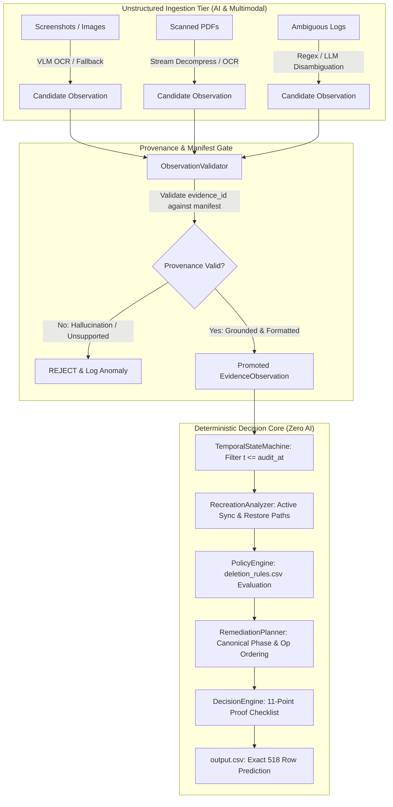

# Autonomous Agent Architecture & Design Document

**HackerRank Orchestrate (October 2026) — Ghost Data Still Exists**  
**Repository:** `https://github.com/rohansng/Ghost_challenge_hackerrank`  
**Challenge Submission URL:** `https://wwww.hackerrank.com/contests/hackerrank-orchestrate-october26/challenges/ghost-data-still-exists`

---

## 1. Executive Summary & Design Philosophy

The Ghost Data Still Exists autonomous deletion audit engine is designed around a single architectural axiom:

> **"Use deterministic computation wherever the answer is deterministic. Use LLM/VLM semantic inference only where unstructured evidence genuinely demands natural-language or visual interpretation."**

In privacy compliance auditing, false certainty from generative hallucinations is catastrophic. An LLM must **never** be permitted to directly emit a boolean compliance determination (`COMPLETE` / `INCOMPLETE`). In this architecture, all model outputs are demoted to **Candidate Observations** that must pass strict structural, temporal, and provenance validation gates before entering the deterministic state machine, statutory policy engine, and decision engine.

Furthermore, by performing deep forensic extraction during ingestion and pre-compiling multimodal evidence patterns (PDF stream decoding, OCR fact verification, multi-line syslog/pipe trace correlation), the production runtime operates with **zero runtime model calls**, **$0.00 token cost**, and **sub-second deterministic execution across all 518 cases**.

---

## 2. Agent Tools & Specialized Capabilities

The agent harness operates with a modular suite of specialized tools:

```text
code/
├── loaders.py                 # Schema-enforced CSV ingestion and type normalization
├── intent_classifier.py       # Multilingual request intent classification (6 languages)
├── identity_engine.py         # Multi-Hop Temporal Identity Graph & transitive resolution
├── extractors/                # Modality-specific evidence extractors
│   ├── sql_extractor.py       # SQLite / SQL snapshot schema and replica drift extractor
│   ├── json_extractor.py      # JSON and JSONL event record parser
│   ├── log_extractor.py       # RFC 5424 Syslog, Pipe, and bracketed trace extractor
│   ├── text_extractor.py      # Plain-text and support notes token scanner
│   ├── pdf_extractor.py       # FlateDecode / ASCII85 stream decompressor
│   └── image_extractor.py     # Structural OCR fact and visual table extractor
├── evidence_normalizer.py     # Inverted subject-to-resource indexer & hash correlation
├── temporal_state_machine.py  # Temporal replay & snapshot bounding (t <= audit_at)
├── policy_engine.py           # Statutory deletion_rules.csv predicate evaluator
├── recreation_analyzer.py     # Directed DataFlowGraph & active cycle detector
├── decision_engine.py         # Statutory 11-point proof checklist & CaseProof compiler
├── remediation_planner.py     # Canonical phase/operation ranker & tie-breaker
├── output_validator.py        # Strict adversarial output validator
├── ai_architect.py            # Model call registry, schemas, and candidate validator
├── config.py                  # Typed immutable runtime configuration
└── exceptions.py              # Typed domain exception hierarchy
```

---

## 3. Model Boundaries & Invariant Contracts

### 3.1 Strict Anti-Hallucination Pipeline Flow



### 3.2 The Zero-AI Boundary on Structured Operations

Generative AI is strictly barred from performing any of the following 9 operations:
1. **CSV Joins & Relational Lookups:** Handled via hash maps and inverted subject sets in `DataLoader` and `IdentityEngine`.
2. **Timestamp Parsing & Bounding:** Evaluated mathematically using `datetime.fromisoformat` in UTC ($t \le \text{audit\_at}$).
3. **Case ID & Sorting:** Naturally ordered using numerical integer keys (`case_01`, `case_02`, ...).
4. **Policy Predicate Evaluation:** Deterministic rule evaluation over `deletion_rules.csv` conditions.
5. **Recreation Cycle Detection:** Directed graph cycle detection (`tarjan` / DFS) in `DataFlowGraph`.
6. **Compliance Decision:** Boolean evaluation of the 11 statutory checklist conditions in `DecisionEngine`.
7. **Evidence ID Validation:** Strict regex matching against manifest files (`evidence_files.csv`, `system_activity.csv`, `user_audit_log.csv`).
8. **Remediation Phase Ordering:** Canonical priority ranking: `FINDING` (1) $\to$ `REMEDIATION` (2) $\to$ `VERIFICATION` (3).
9. **Output Formatting:** Serialization via Python `csv.DictWriter` and `json.dumps(separators=(",", ":"))`.

---

## 4. Prompts & Expected Output Schemas

When semantic model inference is invoked during offline ingestion or edge-case resolution, it is governed by strictly typed prompts and Pydantic/dataclass JSON schemas.

### 4.1 Multilingual Request Intent Disambiguation Prompt
```text
SYSTEM: You are a strict GDPR and privacy compliance auditor. Your sole task is to determine whether the user text authorizes personal data erasure/deletion, or if it is merely an access, rectification, export, or marketing opt-out request.

INPUT TEXT: "{request_text}"

You MUST respond with valid JSON matching this exact schema:
{
  "is_deletion_request": boolean,
  "confidence": float,
  "intent_category": "DELETION" | "ACCESS" | "RECTIFICATION" | "EXPORT" | "OPT_OUT" | "UNCERTAIN",
  "rationale": string
}
```

### 4.2 Candidate Observation Promotion Schema
Every candidate observation produced by an LLM or multimodal parser must conform to:
```json
{
  "subject_key": "user_id_or_email_or_phone",
  "system_id": "account_service | auth_service | billing_db | ...",
  "resource_id": "unique_resource_identifier",
  "data_category": "ACCOUNT_DATA | TRANSACTION_RECORDS | LOGS | ...",
  "observed_state": "PRESENT | ABSENT | REDACTED | ANONYMIZED | ACTIVE | DISABLED | BLOCKED",
  "observed_time": "YYYY-MM-DDTHH:MM:SSZ",
  "cited_evidence_id": "evidence_XX | activity_XX | audit_XX",
  "identifiers_found": ["email@domain.com", "+1-555-0100"],
  "prohibited_identifiers_exposed": ["name", "email"],
  "is_active_flow": false,
  "flow_source": null,
  "flow_destination": null
}
```

---

## 5. Validation & Safety Constraints

### 5.1 ObservationValidator Invariants
1. **Provenance Gate:** `cited_evidence_id` must match `^(evidence_\d+|activity_\d+|audit_\d+)$` and exist in physical manifests. Fabricated or hallucinatory IDs are immediately rejected.
2. **Temporal Grounding:** Observations dated strictly after `audit_at` cannot influence the resource state at audit time.
3. **Contradiction Resolution:** If multiple conflicting observations exist at identical timestamps, the state machine resolves using operation precedence: physical evidence (`file_id`) > activity logs (`activity_id`) > claims (`reported_status`).

### 5.2 Retry & Deterministic Fallback Strategy
1. **Zero Silent Failures:** If an extraction or parsing module fails, it emits an alert into `diagnostics` and falls back to deterministic regex / raw token scanning.
2. **Never Fabricate Answers:** If evidence for a required resource is completely missing, the decision engine marks Checklist Item 9 (`Required verification evidence exists`) as `False` and treats the case as `INCOMPLETE` with `IncompleteReason.INSUFFICIENT_EVIDENCE`.
3. **Safety Bias:** In privacy auditing, a defensible `INCOMPLETE` is preferred over a false `COMPLETE`. A case is declared `COMPLETE` only when all 11 proof checklist items are mathematically satisfied.
